# Sıcaklık İzleyici: ROS 2 Tabanlı Yayıncı–Abone Mimarisi ile Sıcaklık Verisinin Üretilmesi ve Eşik Temelli İzlenmesi

**Paket adı:** `sicaklik_izleyici_py`  
**Hazırlayan:** Kadriye Nur Metin  
**Ders:** Robotiğe Giriş
**Ortam:** ROS 2 Humble Hawksbill, Ubuntu 22.04.5 LTS, Python 3.10.12

## Özet

Bu çalışmada, Robot İşletim Sistemi 2 (ROS 2) üzerinde çalışan, Python (`rclpy`) ile geliştirilmiş iki düğümlü (node) bir uygulama tasarlanmış, gerçekleştirilmiş ve deneysel olarak doğrulanmıştır. Birinci düğüm (`sensor`), her saniye 20–40 °C aralığında düzgün dağılımlı rastgele bir sıcaklık değeri üretip `/sicaklik` konusuna `std_msgs/msg/Float32` türünde yayınlamaktadır. İkinci düğüm (`izleyici`) bu konuya abone olmakta, alınan değeri günlüğe yazmakta ve değer 30 °C eşiğini aştığında `get_logger().warn()` ile uyarı üretmektedir. Ek görev olarak eşik değeri, `declare_parameter` mekanizmasıyla çalışma zamanında değiştirilebilir bir ROS 2 parametresi hâline getirilmiştir. Sistem; `ros2 node`, `ros2 topic`, `ros2 param` komutları ve `rqt_graph` aracıyla doğrulanmıştır. Ölçümlerde yayın periyodunun 1,000 s olduğu (standart sapma ≈ 0,4 ms), eşik karşılaştırmasının hem varsayılan hem de değiştirilmiş eşik değerlerinde doğru çalıştığı ve parametre değişikliğinin düğüm yeniden başlatılmadan bir sonraki mesajda etkili olduğu gözlenmiştir. Raporda ayrıca çalışma sırasında karşılaşılan sorunlar (başta terminalde ortamın tanıtılmaması ve girintide sekme karakteri hatası olmak üzere) ve çözümleri belgelenmiştir.

## Amaç ve Kapsam

Çalışmanın amaçları şunlardır:

1. ROS 2 çalışma alanı (workspace) ve paket yapısının oluşturulması,
2. Periyodik veri yayınlayan bir yayıncı düğümün geliştirilmesi,
3. Bu veriyi tüketen ve koşullu uyarı üreten bir abone düğümün geliştirilmesi,
4. Paketin `entry_points` tanımlarıyla çalıştırılabilir hâle getirilmesi ve `colcon` ile hatasız derlenmesi,
5. Eşik değerinin ROS 2 parametre sistemiyle yapılandırılabilir kılınması,
6. Sistemin ROS 2 komut satırı araçları ve `rqt_graph` ile gözlemlenerek doğrulanması.

## ROS 2

ROS 2, robotik uygulamaların geliştirilmesinde kullanılan, birbirinden bağımsız süreçlerin standartlaştırılmış bir iletişim katmanı üzerinden haberleşmesini sağlayan bir ara katman çatısıdır. İletişim altyapısı olarak Veri Dağıtım Servisi (Data Distribution Service, DDS) standardını kullanır. Bu sayede merkezi bir ana düğüm (ROS 1'deki `roscore`) gerekmeksizin düğümler ağ üzerinde birbirlerini otomatik olarak keşfedebilir.

## Düğüm (Node)

Düğüm, ROS 2 uygulamasında tek bir sorumluluğu yerine getiren en küçük çalıştırılabilir birimdir. Her düğümün ağ içinde benzersiz bir adı vardır. Bu çalışmada `sensor` ve `izleyici` adlı iki düğüm bulunmaktadır.

## Konu (Topic) ve Yayıncı–Abone Modeli

Konular, düğümler arası tek yönlü ve eşzamansız veri akışı için kullanılan adlandırılmış kanallardır. Veri üreten düğüm **yayıncı** (publisher), veriyi tüketen düğüm **abone** (subscriber) rolündedir. Yayıncı ile abone birbirini doğrudan tanımaz; yalnızca konu adı ve mesaj türü üzerinden eşleşirler. Bu **gevşek bağlılık** özelliği, bileşenlerin birbirinden bağımsız değiştirilebilmesini sağlar. Bir konuya birden fazla yayıncı ve birden fazla abone bağlanabilir.

## Mesaj Türü

Konu üzerinden taşınan verinin yapısı mesaj türüyle tanımlanır. Bu çalışmada `std_msgs/msg/Float32` kullanılmıştır. Bu tür, 32 bit kayan noktalı tek bir sayı içeren `data` alanından oluşur. Yayıncı ve abonenin mesaj türleri aynı olmak zorundadır.

## Zamanlayıcı (Timer) ve Geri Çağrı (Callback)

`rclpy`'de `create_timer(periyot, fonksiyon)` çağrısı, belirtilen periyotta ilgili fonksiyonu çağıran bir zamanlayıcı oluşturur. Abonelikte ise yeni bir mesaj geldiğinde çağrılan fonksiyon geri çağrı olarak adlandırılır. Her iki mekanizma da `rclpy.spin()` tarafından yönetilen olay döngüsünde çalışır.

## Parametreler

Parametreler, düğümlerin davranışını kodu değiştirmeden yapılandırmaya yarayan ad–değer çiftleridir. `declare_parameter` ile bir parametre tanımlanır; `ros2 param` komutları veya `--ros-args -p` seçeneğiyle değeri okunabilir ve değiştirilebilir. Bir parametrenin türü, tanımlama sırasında verilen varsayılan değerden belirlenir.

## Paket Yapısı ve Derleme Sistemi

ROS 2 yazılımı paketler hâlinde dağıtılır. Python paketleri `ament_python` derleme türünü kullanır; derleme aracı olarak çoklu paketli çalışma alanlarını derleyen `colcon` kullanılır. Derleme sonucu `build/`, `install/` ve `log/` dizinleri üretilir. `install/setup.bash` betiği kaynaklanarak (source) paket ortama tanıtılır.

## Yazılım Ortamı

Çalışma ortamının doğrulanması amacıyla aşağıdaki komutlar çalıştırılmıştır, ilgili komut çıktıları ve sistemin kurulum durumu Şekil 1 ve Şekil 2'de sunulmuştur.

```bash
printenv ROS_DISTRO
ls /opt/ros/
python3 --version
lsb_release -d
```

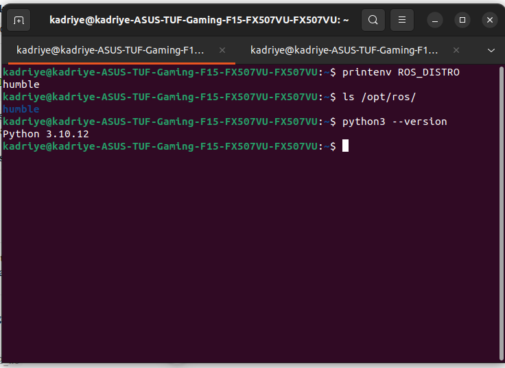

*Şekil 1. `ROS_DISTRO` değişkeninin `humble` olduğu, `/opt/ros/` altında yalnızca `humble` dağıtımının bulunduğu ve Python sürümünün 3.10.12 olduğu görülmektedir.*

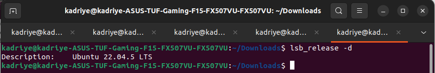

*Şekil 2. Ubuntu sürümünün doğrulanması.*

## Gerekli Yazılımların Kurulumu

Çalışma için gereken yazılımlar ve kurulum komutları Tablo 1'de verilmiştir. Bu çalışmada Ubuntu 22.04 ve ROS 2 Humble önceden kurulu idi; `colcon` ve `rqt_graph` araçlarının kurulu olduğu ilgili şekillerle doğrulanmıştır. Kurulu olmayan bir ortamda her adımdan önce ilgili bileşenin kurulması gerekir.

**Tablo 1. Gerekli yazılımlar ve kurulum komutları**

| Bileşen | Ne için gerekli | Kurulum |
|---|---|---|
| ROS 2 Humble | Düğümler, `rclpy`, `std_msgs`, `ros2` komutları | Resmî kurulum kılavuzundaki adımlar izlenerek depo eklendikten sonra `sudo apt install ros-humble-desktop` |
| `colcon` | Paketin derlenmesi | `sudo apt install python3-colcon-common-extensions` |
| `rqt_graph` | Hesaplama grafiğinin görüntülenmesi | `sudo apt install ros-humble-rqt-graph` (`ros-humble-desktop` ile birlikte gelir) |
| `git` | Kaynak kodun GitHub'a yüklenmesi | `sudo apt install git` |

`colcon` aracının kurulu olduğu Şekil 3'te, `rqt_graph` aracının çalıştığı ise Şekil 19'da görülmektedir.

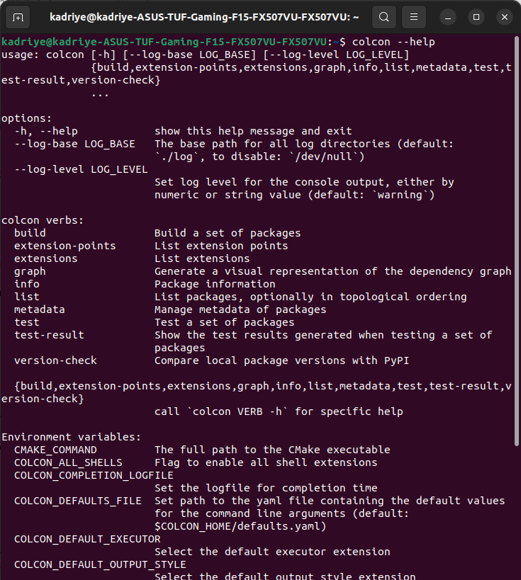

*Şekil 3. `colcon --help` çıktısı. Aracın kurulu olduğu ve `build`, `list`, `info` gibi komutlara sahip olduğu görülmektedir.*

## Çalışma Alanının Oluşturulması

ROS 2 kaynak kodları bir çalışma alanında tutulur. Çalışma alanının yapısı aşağıdaki gibidir:

```
ros2_ws/
├── src/        ← Kaynak kodlar (paketler)
├── build/      ← Derleme ara dosyaları
├── install/    ← Derlenmiş, çalıştırmaya hazır hâl
└── log/        ← Derleme günlükleri
```

```bash
mkdir -p ~/ros2_ws/src
ls ~/ros2_ws
```

Komutun çıktısında `src` dizini görülmüştür. `build`, `install` ve `log` dizinleri ilk derlemede `colcon` tarafından oluşturulmuştur.

## Paketin Oluşturulması

Paketler her zaman çalışma alanının `src/` dizininde oluşturulur. Bu nedenle önce bu dizine geçilmiş ve paket aşağıdaki komutla oluşturulmuştur:

```bash
cd ~/ros2_ws/src
ros2 pkg create --build-type ament_python sicaklik_izleyici_py \
  --dependencies rclpy std_msgs \
  --description "Rastgele sicaklik uretip izleyen ROS 2 paketi" \
  --license Apache-2.0
```

Komutun parametreleri şöyledir:

- `--build-type ament_python`: Paketin Python tabanlı olduğunu belirtir (C++ için alternatif `ament_cmake`'dir).
- `--dependencies rclpy std_msgs`: `package.xml` dosyasına `rclpy` (ROS 2 Python istemci kütüphanesi) ve `std_msgs` (standart mesaj türleri) bağımlılıklarını ekler.
- `--description` ve `--license`: Verilmediğinde `package.xml` içinde `TODO` olarak kalan alanları doldurur.

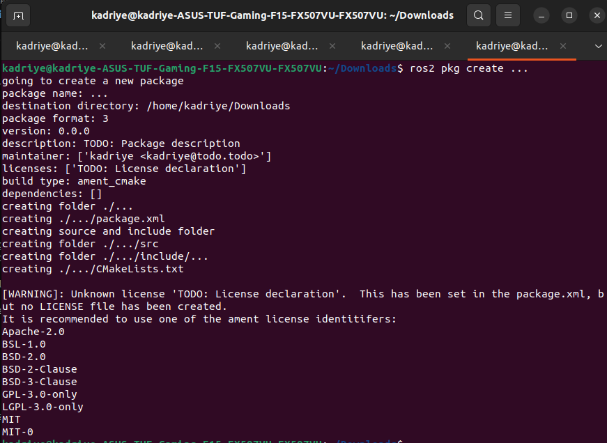

*Şekil 4. Paket oluşturma komutunun çıktısı.*

Oluşan dizin yapısı Şekil 5'te gösterilmiştir.

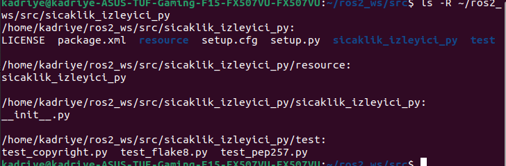

*Şekil 5. `ls -R` ile paket dizin yapısı. İç içe iki `sicaklik_izleyici_py` dizini bulunmaktadır: dıştaki paketin kendisi, içteki Python kaynak kodlarının yer alacağı dizindir.*

**Tablo 2. Paket dosyalarının işlevleri**

| Dosya / dizin | İşlevi |
|---|---|
| `package.xml` | Paketin kimlik bilgileri: ad, sürüm, açıklama, bakımcı, lisans, bağımlılıklar |
| `setup.py` | Python kurulum betiği; `entry_points` ile çalıştırılabilir komutlar burada tanımlanır |
| `setup.cfg` | Çalıştırılabilir dosyaların kurulum dizinini belirtir |
| `resource/sicaklik_izleyici_py` | ROS 2'nin paketi tanımasını sağlayan işaretçi dosya |
| `LICENSE` | Apache-2.0 lisans metni |
| `test/` | Kod stili denetimi yapan hazır testler |
| `sicaklik_izleyici_py/__init__.py` | Python'un dizini paket olarak tanımasını sağlar; kaynak kodlar bu iç dizine yazılır |

Şekil 6'da `package.xml` dosyasının içeriği görülmektedir. `rclpy` ve `std_msgs` bağımlılıkları, açıklama ve lisans alanları komutun parametrelerinden otomatik doldurulmuştur. Bakımcı alanı ise bu aşamada varsayılan değerdedir ve bir sonraki adımda düzeltilmiştir.

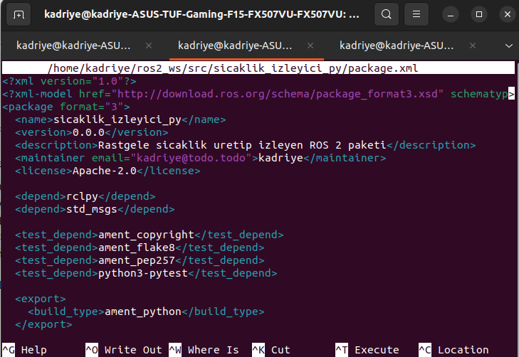

*Şekil 6. `package.xml` dosyasının `nano` ile açılmış hâli. Bağımlılıklar (`rclpy`, `std_msgs`) ve `ament_python` derleme türü görülmektedir; `maintainer` alanı henüz varsayılan değerdedir.*

## Bakımcı Bilgilerinin Düzenlenmesi

`package.xml` ve `setup.py` dosyalarındaki bakımcı alanları, varsayılan `todo` değerleri yerine gerçek bilgilerle doldurulmuştur. Aynı bilginin iki dosyada tutarlı olması, paket üst verisinin güvenilirliği açısından gereklidir.

```bash
nano ~/ros2_ws/src/sicaklik_izleyici_py/package.xml
nano ~/ros2_ws/src/sicaklik_izleyici_py/setup.py
```

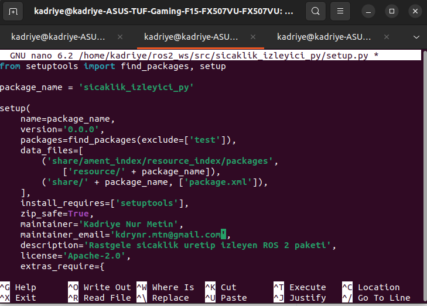

*Şekil 7. `setup.py` dosyasında `maintainer` ve `maintainer_email` alanlarının düzenlenmesi.*

Düzenlemenin her iki dosyada da yapıldığı aşağıdaki komutla doğrulanmıştır. Şekil 8'de doğrulama çıktılarını inceleyebilrsiniz.

```bash
grep -n "maintainer" ~/ros2_ws/src/sicaklik_izleyici_py/package.xml ~/ros2_ws/src/sicaklik_izleyici_py/setup.py
```

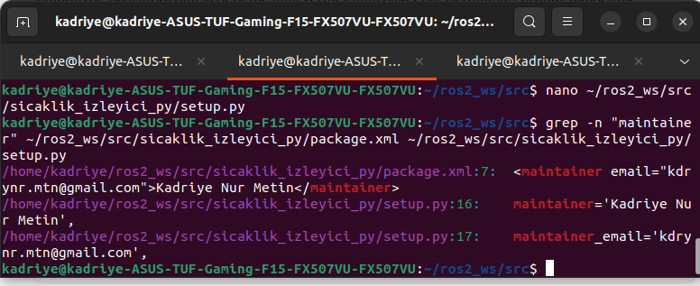

*Şekil 8. `package.xml` (7. satır) ile `setup.py` (16. ve 17. satırlar) içindeki bakımcı bilgilerinin aynı olduğu ve `todo` ifadesinin kalmadığı görülmektedir.*

## Yayıncı Düğüm: `sensor.py`

sensor.py (yayıncı düğüm), projedeki veri kaynağıdır ve sistemin çalışması için gereken ham veriyi üretir. Dosya, **iç** `sicaklik_izleyici_py` dizinine (`__init__.py` dosyasının yanına) oluşturulmuştur.

**Tablo 3. `sensor.py` bileşenlerinin açıklaması**

| Bileşen | Açıklama |
|---|---|
| `class SensorDugumu(Node)` | `rclpy.node.Node` sınıfından türetilen düğüm sınıfıdır. |
| `super().__init__('sensor')` | Düğümün ROS ağındaki adını `sensor` olarak kaydeder. |
| `create_publisher(Float32, '/sicaklik', 10)` | Mesaj türü, konu adı ve kuyruk derinliği ile yayıncı oluşturur. |
| `create_timer(1.0, ...)` | 1 saniye periyotlu zamanlayıcı kurar; her tetiklenmede geri çağrı çalışır. |
| `random.uniform(20.0, 40.0)` | [20, 40] aralığında ondalıklı rastgele sayı üretir. `Float32` türü ondalıklı değer beklediğinden tam sayı üreten `randint` tercih edilmemiştir. |
| `publish(mesaj)` | Mesajı konuya gönderir. |
| `rclpy.spin(dugum)` | Olay döngüsünü çalıştırır; zamanlayıcı bu döngü içinde işletilir. |
| `try / except / finally` | Kesme sinyalinde (Ctrl+C) düğümü düzgün biçimde yok eder. `rclpy.ok()` denetimi, kapatma işleminin iki kez çağrılmasından doğan hatayı önler. |

### Derlemeden Önce Ön Deneme

`entry_points` henüz tanımlanmadığından `ros2 run` kullanılamamış; mantığı doğrulamak için dosya doğrudan Python ile çalıştırılmıştır:

```bash
cd ~/ros2_ws/src/sicaklik_izleyici_py/sicaklik_izleyici_py
python3 sensor.py
```

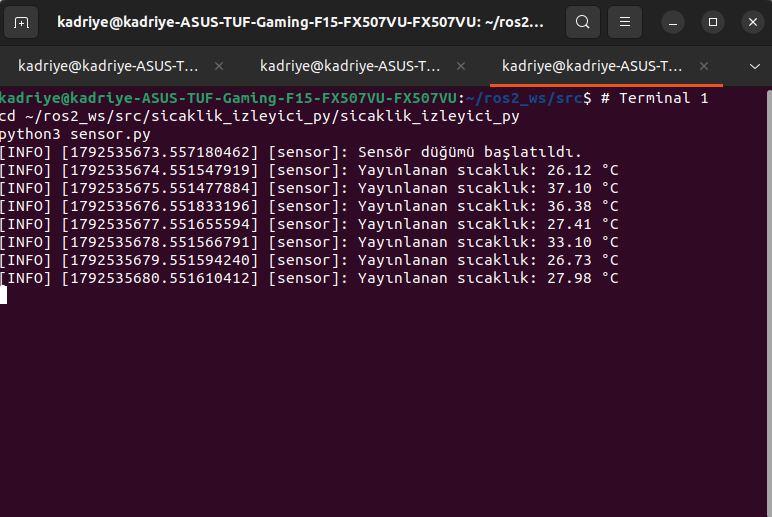

*Şekil 9. `sensor.py` dosyasının doğrudan çalıştırılması. Zaman damgalarından değerlerin 1 saniye arayla yayınlandığı ve tüm değerlerin 20–40 °C aralığında kaldığı görülmektedir.*

Yayının yalnızca düğümün kendi günlüğünde değil, ROS ağında da görüldüğü, bağımsız bir abone olarak `ros2 topic echo` ile doğrulanmıştır:

```bash
ros2 topic echo /sicaklik
```

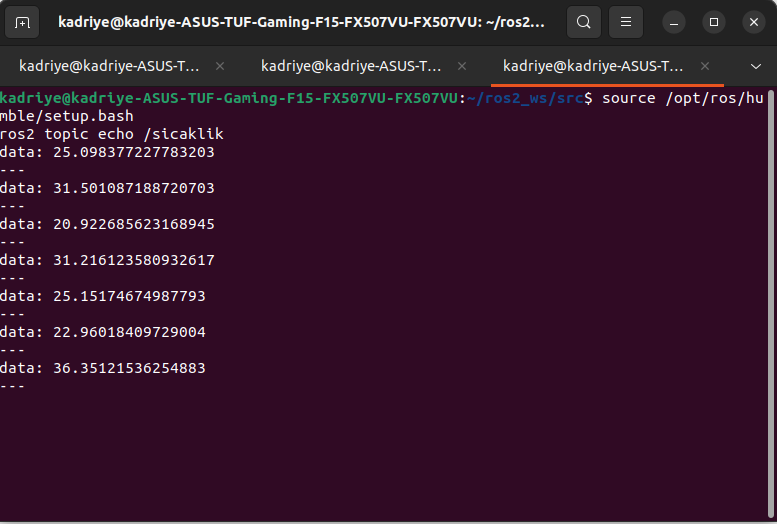

*Şekil 10. `ros2 topic echo /sicaklik` çıktısı. `data` alanında 20–40 aralığında değerler akmaktadır. `25.098377227783203` gibi uzun ondalık kuyrukları, 32 bitlik `Float32` değerinin 64 bitlik olarak yazdırılmasından kaynaklanır.*

## Abone Düğüm: `izleyici.py` (Sürüm 1: Sabit Eşik)

izleyici.py (abone düğüm), /sicaklik konusunu dinleyerek verileri tüketen ve eşik kontrolü yapan bileşendir.
Önce eşik, kod içinde sabit bir değer olarak tanımlanmıştır. Parametre sürümü, "Eşik Değerinin Parametreleştirilmesi (Ek Görev)" başlığında ele alınmıştır. Kodun temel fonksiyonları Tablo 4'te açıklanmışıtr.

**Tablo 4. `izleyici.py` bileşenlerinin açıklaması**

| Bileşen | Açıklama |
|---|---|
| `ESIK = 30.0` | Eşik değeri; sınıf düzeyinde sabit olarak tutulmuştur. |
| `create_subscription(Float32, '/sicaklik', geri_cagri, 10)` | Aynı konu adı ve mesaj türüne abone olur. Konu adı ve tür yayıncıdakiyle birebir aynı olmak zorundadır; aksi hâlde hata mesajı üretilmeden iki düğüm birbirini görmez. |
| `sicaklik_geri_cagrisi` | Her yeni mesajda ROS 2 tarafından çağrılan geri çağrı fonksiyonudur. |
| `get_logger().info(...)` | Her değeri INFO düzeyinde yazdırır. |
| `if deger > self.ESIK` | Eşik aşımını denetler. |
| `get_logger().warn(...)` | Yalnızca eşik aşıldığında WARN düzeyinde kayıt üretir; terminalde ayırt edici renkle görüntülenir. |

Sürüm 1 de önce doğrudan Python ile denenmiştir (`sensor.py` ayrı bir terminalde çalışırken):

```bash
python3 izleyici.py
```

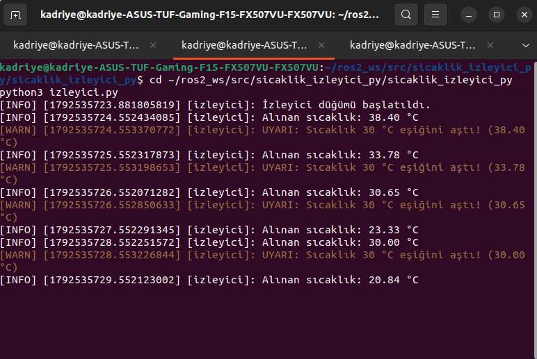

*Şekil 11. `izleyici.py` dosyasının doğrudan çalıştırılması. 30 °C üzerindeki değerler (38.40, 33.78, 30.65) için `WARN` kaydı üretilmiş; 23.33 ve 20.84 değerleri için üretilmemiştir. `30.00` olarak görünen değer için uyarı üretilmesi, günlükteki iki basamaklı yuvarlamadan kaynaklanır; karşılaştırma yuvarlanmamış değerle yapıldığından gerçek değer 30.0'dan çok az büyüktür.*

## Çalıştırılabilir Girdi Noktalarının Tanımlanması

`setup.py` içindeki `console_scripts` listesinde (Şekil 12) her satırın biçimi `komut_adı = python_paketi.modül:fonksiyon` şeklindedir. Birinci satırda `sensor` komut adı, `sicaklik_izleyici_py` iç dizin (Python paketi), `sensor` modül (`sensor.py`), `main` ise çalıştırılacak fonksiyondur.

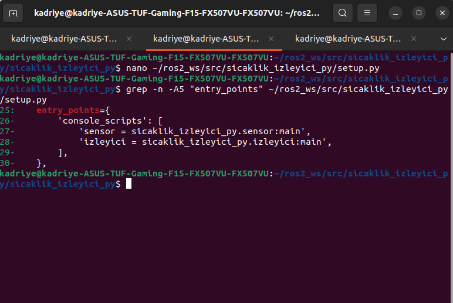

*Şekil 12. `grep -n -A5 "entry_points" setup.py` çıktısı. `console_scripts` listesinde iki komutun tanımlandığı görülmektedir.*

## Derleme

> **Ön koşul:** `colcon` kurulu olmalıdır (`sudo apt install python3-colcon-common-extensions`). Derleme, çalışma alanının **kök** dizininde (`~/ros2_ws`) yapılmalıdır; `src/` içinde yapılırsa yanlış konumda `build/`, `install/`, `log/` dizinleri oluşur.

```bash
cd ~/ros2_ws
colcon build --packages-select sicaklik_izleyici_py
```

`--packages-select` seçeneği yalnızca belirtilen paketi derler.

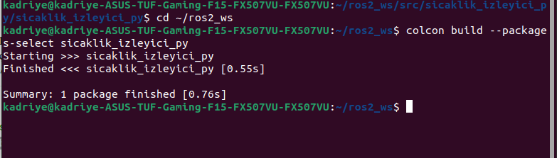

*Şekil 13. `colcon build` çıktısı. Derleme 0.55 s'de, `stderr` çıktısı olmadan tamamlanmıştır (`Summary: 1 package finished`).*

Derlenen paketin ROS 2'ye tanıtıldığı aşağıdaki komutla doğrulanmıştır:

```bash
ros2 pkg executables sicaklik_izleyici_py
```

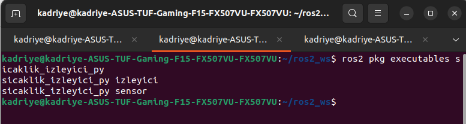

*Şekil 14. `ros2 pkg executables` çıktısı. `izleyici` ve `sensor` komutlarının kayıtlı olduğu, yani `entry_points` tanımının çalıştığı görülmektedir.*

## Ortamın Otomatik Kaynaklanması (İsteğe Bağlı)

Her yeni terminalde `source /opt/ros/humble/setup.bash` ve `source ~/ros2_ws/install/setup.bash` komutlarının elle yazılması gerekir. Kolaylık amacıyla bu iki satır, her yeni terminalde bash tarafından otomatik çalıştırılan `~/.bashrc` dosyasının sonuna eklenmiştir:

```bash
echo "source /opt/ros/humble/setup.bash" >> ~/.bashrc
echo "source ~/ros2_ws/install/setup.bash" >> ~/.bashrc
```

Eklemenin doğruluğu şu komutla denetlenmiştir ve aşağıdaki çıktı alınmıştır:

```bash
grep -n "ros" ~/.bashrc
```

```
118:source /opt/ros/humble/setup.bash
119:source ~/ros2_ws/install/setup.bash
```

## `ros2 run` ile Çalıştırma

İki düğüm, ayrı terminallerde `ros2 run` ile başlatılmıştır. rogramın çalıştırılması esnasında terminallerde elde edilen çıktılar sırasıyla Şekil 15 ve Şekil 16'da sunulmuştur.:

```bash
# Terminal 1
ros2 run sicaklik_izleyici_py sensor

# Terminal 2
ros2 run sicaklik_izleyici_py izleyici
```

Komutun yapısı `ros2 run <paket_adı> <komut_adı>` biçimindedir; komut adı `setup.py` içinde `=` işaretinin solundaki addır.

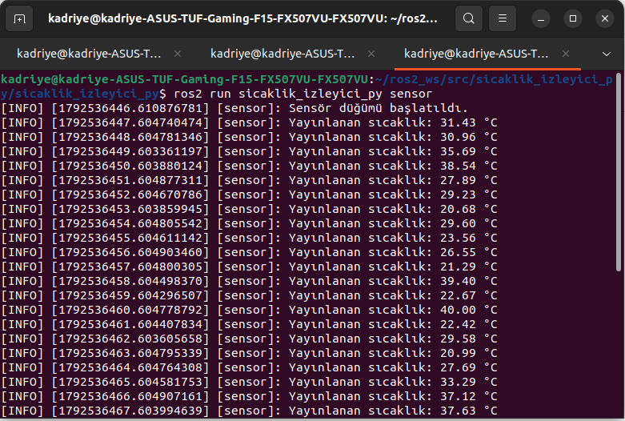

*Şekil 15. `ros2 run sicaklik_izleyici_py sensor` çıktısı.*

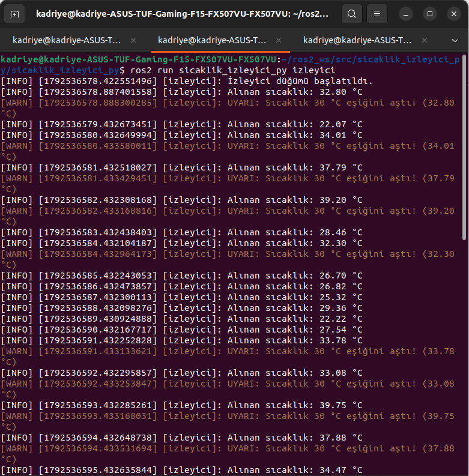

*Şekil 16. `ros2 run sicaklik_izleyici_py izleyici` çıktısı. 30 °C üzerindeki değerler için `WARN` (turuncu), diğerleri için yalnızca `INFO` kaydı üretilmiştir.*

---

## Sistemin Dışarıdan Gözlemlenmesi

İki düğüm çalışırken üçüncü bir terminalde aşağıdaki komutlar çalıştırılmıştır:

```bash
ros2 node list
ros2 topic info /sicaklik
ros2 topic hz /sicaklik
```

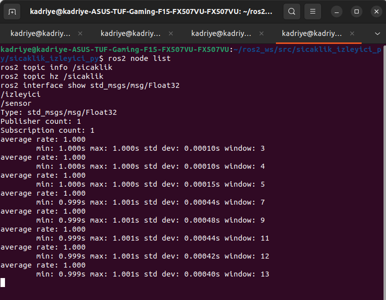

*Şekil 17. `ros2 node list`, `ros2 topic info /sicaklik` ve `ros2 topic hz /sicaklik` çıktıları.*

**Tablo 5. Sistemin dışarıdan doğrulanması**

| Komut | Gözlem (Şekil 17) | Çıkarım |
|---|---|---|
| `ros2 node list` | `/izleyici`, `/sensor` | İki düğüm ağda keşfedilmiştir; adlar koddaki `super().__init__('...')` değerleridir. |
| `ros2 topic info /sicaklik` | Tür `std_msgs/msg/Float32`; `Publisher count: 1`; `Subscription count: 1` | Konu ve tür doğrudur; bir yayıncı ile bir abone eşleşmiştir. |
| `ros2 topic hz /sicaklik` | `average rate: 1.000`; son pencerede (13 örnek) `min: 0.999 s`, `max: 1.001 s`, `std dev: 0.00040 s` | Yayın periyodu 1 s'dir; sapma milisaniyenin altındadır. "Her saniye" gereksinimi ölçülerek doğrulanmıştır. |


## Hesaplama Grafiği (`rqt_graph`)

> **Ön koşul:** `rqt_graph` kurulu olmalıdır (`sudo apt install ros-humble-rqt-graph`; `ros-humble-desktop` ile birlikte gelir).

İki düğüm çalışırken üçüncü bir terminalde `rqt_graph` başlatılmıştır:

```bash
rqt_graph
```

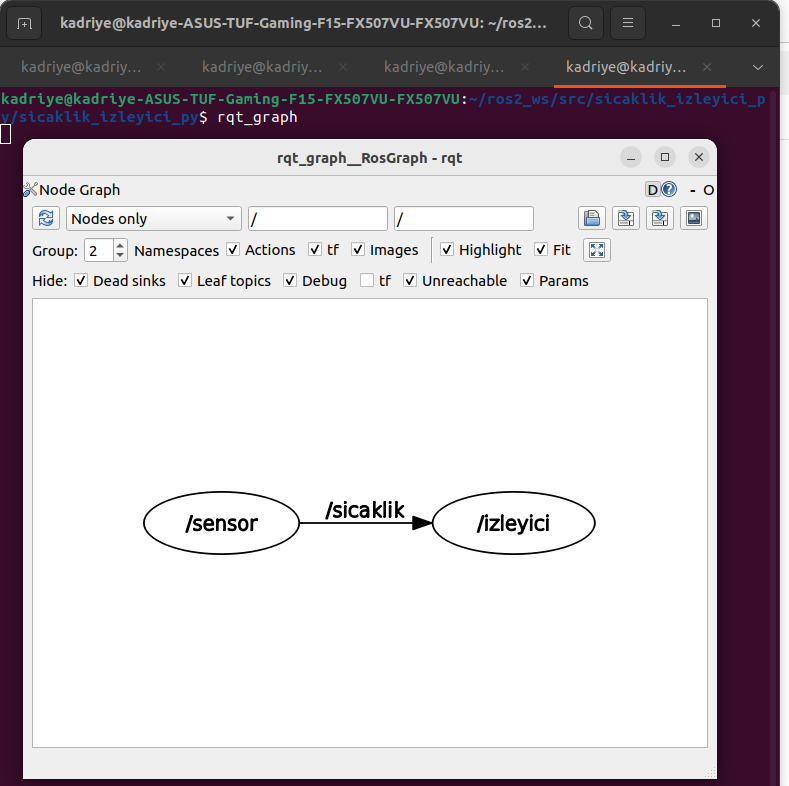

*Şekil 19. `rqt_graph` çıktısı (görünüm: Nodes only). `/sensor` düğümünden `/sicaklik` konusu üzerinden `/izleyici` düğümüne tek yönlü bir bağlantı görülmektedir.*

Konunun bağımsız bir öğe olarak gösterildiği görünüm de alınmıştır:

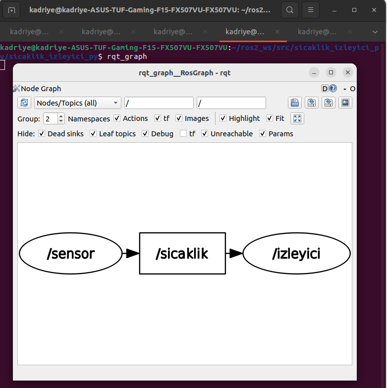

*Şekil 20. `rqt_graph` çıktısı (görünüm: Nodes/Topics (all)). Yayıncı düğüm, konu (dikdörtgen) ve abone düğüm ayrı öğeler olarak çizilmiştir. Bu, yayıncı ile abonenin birbirini doğrudan değil, konu üzerinden tanıdığını göstermektedir.*

Grafikte `/izleyici` düğümünden çıkan bir ok bulunmaması, bu düğümün yalnızca dinleyici olduğunu, hiçbir konuya veri yayınlamadığını doğrulamaktadır.

## Eşik Davranışının Doğrulanması

Varsayılan eşikle (30.0 °C) yapılan gözlemde, Şekil 16'da tam olarak görünen ilk 17 mesaj Tablo 6'da dökülmüştür.

**Tablo 6. Eşik davranışı gözlemi (eşik 30.0 °C)**

| Sıra | Alınan değer (°C) | Uyarı üretildi mi? |
|---|---|---|
| 1 | 32.80 | Evet |
| 2 | 22.07 | Hayır |
| 3 | 34.01 | Evet |
| 4 | 37.79 | Evet |
| 5 | 39.20 | Evet |
| 6 | 28.46 | Hayır |
| 7 | 32.30 | Evet |
| 8 | 26.70 | Hayır |
| 9 | 26.82 | Hayır |
| 10 | 25.32 | Hayır |
| 11 | 29.36 | Hayır |
| 12 | 22.22 | Hayır |
| 13 | 27.54 | Hayır |
| 14 | 33.78 | Evet |
| 15 | 33.08 | Evet |
| 16 | 39.75 | Evet |
| 17 | 37.88 | Evet |

Toplam 17 mesajın 9'u 30 °C'nin üzerindedir ve tam olarak 9 uyarı üretilmiştir. En küçük değer 22.07 °C, en büyük değer 39.75 °C'dir; tüm değerler [20, 40] aralığındadır.

---

## Eşik Değerinin Parametreleştirilmesi (Ek Görev)

Sabit `ESIK = 30.0` ifadesi yerine, varsayılan değeri 30.0 olan `esik_degeri` adlı bir ROS 2 parametresi tanımlanmıştır. Parametre sisteminin üç aşaması vardır:

| Aşama | Kodda |
|---|---|
| Tanımlama | `declare_parameter('esik_degeri', 30.0)` |
| Okuma | `get_parameter('esik_degeri')` |
| Dışarıdan değiştirme | `--ros-args -p esik_degeri:=35.0` veya `ros2 param set` |

ROS 2'de tanımlanmamış bir parametre kullanılamaz. Varsayılan değer olarak `30.0` verildiği için parametre belirtilmediğinde davranış Sürüm 1 ile aynı kalır. Parametre değeri, `__init__` içinde bir kez okunmak yerine her geri çağrıda okunmuştur; böylece çalışma sırasında yapılan değişiklik düğüm yeniden başlatılmadan bir sonraki mesajda etkili olur.

`izleyici.py` üzerinde iki değişiklik yapılmıştır: (1) `ESIK = 30.0` satırı silinmiş, `__init__` içine `self.declare_parameter('esik_degeri', 30.0)` eklenmiştir; (2) geri çağrı fonksiyonu eşiği parametreden okuyacak biçimde değiştirilmiştir.

`ros2 run`, `install/` dizinindeki derlenmiş kopyayı çalıştırdığından, kod değişikliğinden sonra paket yeniden derlenmiştir. Yalnızca Python dosyası değiştiği ve paket daha önce tanıtıldığı için yeniden `source` gerekmemiş, çalışan düğümün yeniden başlatılması yeterli olmuştur.

```bash
cd ~/ros2_ws
colcon build --packages-select sicaklik_izleyici_py
```

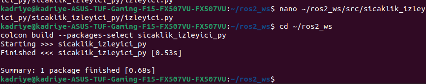

*Şekil 21. Parametreli sürümün derlenmesi. Derleme `stderr` çıktısı olmadan tamamlanmıştır (aşağıdaki "Sorun 2: Sekme (Tab) Karakteri Hatası" başlığında anlatılan hatanın giderilmesinden sonra alınan çıktıdır).*

## Parametre Deneyleri

Üç deney yapılmıştır. `sensor` düğümü her deney boyunca ayrı bir terminalde çalışmıştır.

**Deney 1 — Varsayılan değer.** İzleyici parametresiz başlatılmış, parametre sistemi sorgulanmıştır:
Şekil 22'de görüldüğü üzere, dışarıdan bir değer atanmadığında sistemin koddaki varsayılan değer olan 30.0 ile çalıştığı bu deneyle doğrulanmıştır.

```bash
ros2 param list
ros2 param get /izleyici esik_degeri
```

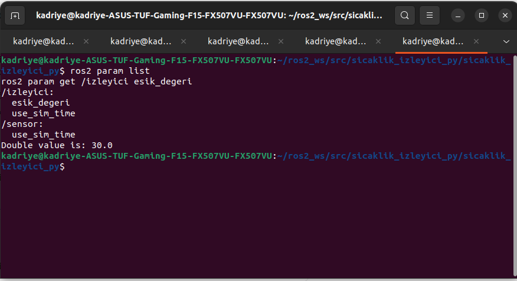

*Şekil 22. `/izleyici` düğümü altında `esik_degeri` ve `use_sim_time`, `/sensor` düğümü altında yalnızca `use_sim_time` parametreleri listelenmiştir (`use_sim_time`, ROS 2'nin her düğüm için kendiliğinden tanımladığı bir parametredir). `ros2 param get` komutu `Double value is: 30.0` değerini döndürmüştür.*

**Deney 2 — Başlangıçta değer verme.** Eşik, düğüm başlatılırken 35.0 olarak verilmiştir:

```bash
ros2 run sicaklik_izleyici_py izleyici --ros-args -p esik_degeri:=35.0
```

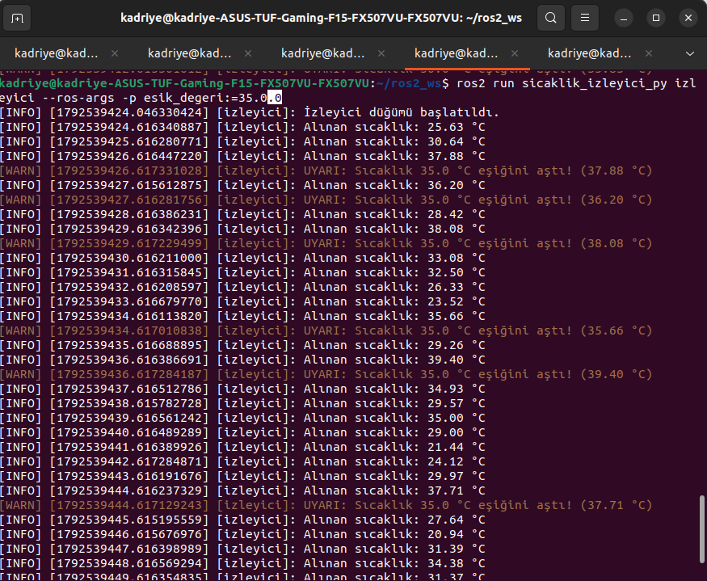

*Şekil 23. Eşik 35.0 iken izleyici çıktısı. Uyarılar `35.0 °C eşiğini aştı` metniyle üretilmiştir. 30 °C'nin üzerinde olan 30.64, 31.39, 32.50 ve 33.08 değerleri uyarı üretmemiş; 35.66, 36.20, 37.71, 37.88, 38.08 ve 39.40 değerleri üretmiştir. Ekranda `35.00` olarak görünen değer eşiğe eşit ya da eşiğin altında kaldığından uyarı üretmemiştir.*

**Deney 3 — Çalışırken değiştirme.** İzleyici çalışırken ayrı bir terminalde eşik 25.0 olarak değiştirilmiştir:

```bash
ros2 param set /izleyici esik_degeri 25.0
```

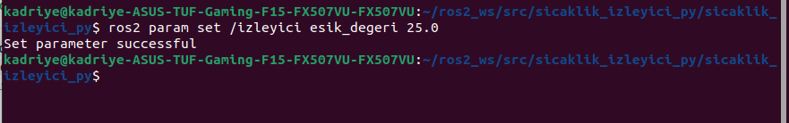

*Şekil 24. `ros2 param set` komutu `Set parameter successful` yanıtını vermiştir.*

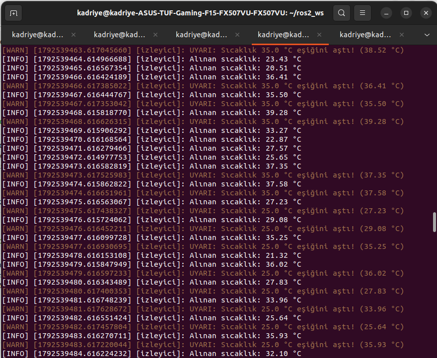

*Şekil 25. Eşiğin çalışırken 35.0'dan 25.0'a geçişi. Değişiklikten önce gelen 25.65 °C değeri (eşik o anda 35.0 olduğundan) uyarı üretmemiş, 37.35 ve 37.58 °C değerleri `35.0 °C eşiğini aştı` uyarısı üretmiştir. Hemen sonraki mesaj olan 27.23 °C ise `25.0 °C eşiğini aştı` uyarısı üretmiştir. Düğüm yeniden başlatılmamıştır.*


## Parametre Deney Sonuçlarının Özeti

**Tablo 7. Parametre deneylerinin özeti**

| Deney | Komut | Sonuç |
|---|---|---|
| 1. Varsayılan değer | `ros2 param get /izleyici esik_degeri` | `Double value is: 30.0` |
| 2. Başlangıçta değer | `-p esik_degeri:=35.0` | Uyarılar 35.0 eşiğiyle üretildi; 30–35 arası değerler uyarısız kaldı. |
| 3. Çalışırken değiştirme | `ros2 param set /izleyici esik_degeri 25.0` | `Set parameter successful`; eşik bir sonraki mesajdan itibaren 25.0 oldu, yeniden başlatma gerekmedi. |

Deney 3, eşiğin her geri çağrıda okunması tasarım kararının doğrudan sonucudur. Parametrenin türü, `declare_parameter` çağrısındaki varsayılan değerden (`30.0`, yani `double`) belirlendiğinden, `ros2 param set` ile değer verilirken `25.0` biçiminde ondalıklı yazılmalıdır.

---

## Karşılaşılan Sorunlar ve Çözümleri

**Tablo 8. Karşılaşılan sorunlar ve çözümleri**

| No | Sorun | Neden | Çözüm |
|---|---|---|---|
| 1 | `ros2 run sicaklik_izleyici_py izleyici` komutu `Package 'sicaklik_izleyici_py' not found` hatası verdi. | Komut, `colcon build` yapılmadan önce açılmış eski bir terminalde çalıştırılmıştı. `.bashrc` yalnızca terminal açılırken okunur; o anda `~/ros2_ws/install/setup.bash` henüz yoktu. | O terminalde `source ~/.bashrc` çalıştırıldı (alternatif: yeni terminal açmak). |
| 2 | Parametreli sürümün derlenmesi `TabError` içeren `stderr` çıktısı verdi. | `izleyici.py` içinde 20. satırın girintisinde sekme (Tab) karakteri vardı; diğer satırlar boşlukla girintiliydi. | Sekmeler boşlukla değiştirildi ve paket yeniden derlendi (aşağıya bakınız). |
| 3 | `ros2 interface show` komutu çalışmadı. | Komut, sonsuza dek çalışan `ros2 topic hz` komutuyla aynı satırlara yazılmıştı. | Komut ayrıca çalıştırıldı (bkz. "Sistemin Dışarıdan Gözlemlenmesi"). |


## Sonuç

Bu çalışmada ROS 2 Humble üzerinde, Python ile geliştirilmiş yayıncı–abone tabanlı bir sıcaklık izleme sistemi gerçekleştirilmiştir. `sensor` düğümü 1 Hz sıklıkta (ölçülen standart sapma ≈ 0,4 ms) 20–40 °C aralığında değer yayınlamış, `izleyici` düğümü bu değerleri alarak 30 °C eşiğinin aşıldığı durumlarda uyarı üretmiştir; 17 mesajlık gözlemde 30 °C üzerindeki 9 değerin tamamı için uyarı verilmiş, eşiğin altındaki hiçbir değer için verilmemiştir. Eşik değeri ROS 2 parametresi olarak tanımlanmış; başlangıçta verilebildiği ve çalışırken düğüm yeniden başlatılmadan değiştirilebildiği gösterilmiştir. Paket `colcon` ile hatasız derlenmiş, düğümler `ros2 run` ile çalıştırılmış ve sistem `ros2 node`, `ros2 topic`, `ros2 param` komutları ile `rqt_graph` aracıyla doğrulanmıştır. Çalışma; düğüm, konu, mesaj türü, parametre, paket yapısı ve derleme zincirine ilişkin temel kavramların uygulamalı olarak pekiştirilmesini sağlamıştır.

---

## Proje Dizin Yapısı

```
sicaklik_izleyici_py/
├── README.md
├── .gitignore
├── LICENSE
├── package.xml
├── setup.py
├── setup.cfg
├── resource/
│   └── sicaklik_izleyici_py
├── test/
├── docs/
│   └── images/               ← Bu belgedeki ekran görüntüleri (sekilNN_*.png)
└── sicaklik_izleyici_py/
    ├── __init__.py
    ├── sensor.py
    └── izleyici.py
```

---

## Yeniden Üretim İçin Hızlı Çalıştırma Özeti

Önkoşullar: Ubuntu 22.04, ROS 2 Humble, `colcon` (Tablo 1).

```bash
# 1) Depoyu çalışma alanına klonlayın
mkdir -p ~/ros2_ws/src
cd ~/ros2_ws/src
git clone https://github.com/kdrynrmtn/sicaklik_izleyici_py.git

# 2) Derleyin (önce ROS 2 ortamı kaynaklanmalıdır)
source /opt/ros/humble/setup.bash
cd ~/ros2_ws
colcon build --packages-select sicaklik_izleyici_py
source install/setup.bash

# 3) Çalıştırın (iki ayrı terminal; her birinde iki source komutu gerekir)
ros2 run sicaklik_izleyici_py sensor
ros2 run sicaklik_izleyici_py izleyici

# 4) (İsteğe bağlı) Eşiği parametre ile verin
ros2 run sicaklik_izleyici_py izleyici --ros-args -p esik_degeri:=35.0

# 5) (İsteğe bağlı) Çalışırken değiştirin (üçüncü terminal)
ros2 param set /izleyici esik_degeri 25.0

# 6) (İsteğe bağlı) Hesaplama grafiği
rqt_graph
```